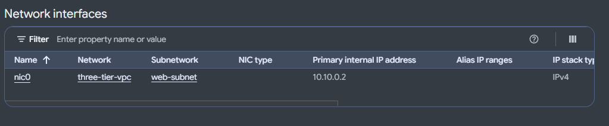
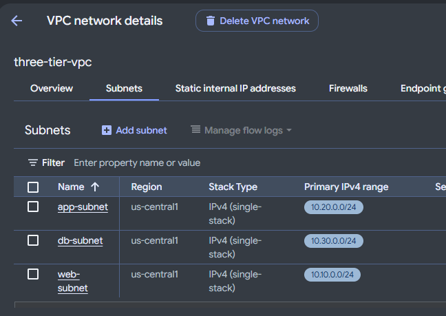
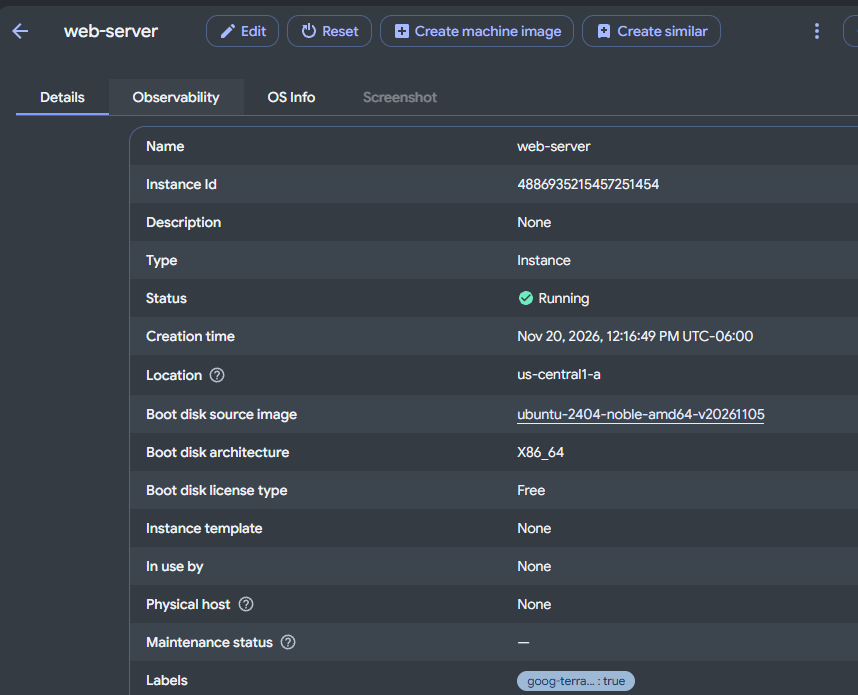
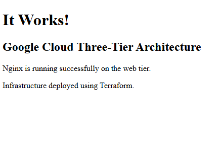

# GCP Secure Three-Tier Architecture

## Project Overview

This project demonstrates the design and deployment of a secure, segmented network architecture on Google Cloud Platform (GCP) using Terraform.

The goal is to demonstrate practical Cloud Engineering skills, including Infrastructure as Code (IaC), VPC networking, subnet segmentation, firewall configuration, Linux server administration, and infrastructure lifecycle management.

## Cloud Environment

- **Cloud Provider:** Google Cloud Platform
- **Infrastructure as Code:** Terraform
- **Operating System:** Ubuntu 24.04 LTS
- **Web Server:** Nginx
- **Region:** us-central1

## Architecture

The network is divided into three separate subnets:

| Tier | Subnet | CIDR Range |
|---|---|---|
| Web | web-subnet | 10.10.0.0/24 |
| Application | app-subnet | 10.20.0.0/24 |
| Database | db-subnet | 10.30.0.0/24 |

**Network:** three-tier-vpc

## Security Configuration

Four ingress firewall rules were implemented:

- Public HTTP/HTTPS access to the web tier on ports 80 and 443.
- Web-to-application communication on TCP 8080.
- Application-to-database communication on TCP 5432.
- SSH administration through Identity-Aware Proxy (IAP) on TCP 22.

The firewall rules use network tags and restricted source ranges to control access between tiers.

## Deployment Demonstration

A temporary Ubuntu 24.04 Compute Engine VM was deployed in the web subnet using Terraform.

The VM used:
- Machine type: e2-micro
- Boot disk: 10 GB standard persistent disk
- Web server: Nginx
- Temporary external IPv4 address

A startup script installed Nginx and published a custom demonstration webpage.

The website was successfully tested using HTTP and returned:

`HTTP/1.1 200 OK`

After collecting portfolio screenshots, the temporary VM was destroyed to minimize ongoing cloud costs.

## Current Infrastructure Status

**Deployed and retained:**
- Custom VPC network
- Three regional subnets
- Four firewall rules

**Demonstrated and subsequently destroyed:**
- Temporary public Nginx web server VM

**Future development:**
- Private application server
- PostgreSQL database tier
- Additional IAM and security hardening
- Monitoring and logging

## Repository Structure

```text
gcp-secure-three-tier/
├── examples/
│   └── temporary-web-vm.tf
├── terraform/
│   ├── providers.tf
│   ├── variables.tf
│   ├── network.tf
│   ├── firewall.tf
│   ├── terraform.tfvars.example
│   └── .terraform.lock.hcl
├── .gitignore
└── README.md
```

## Technologies and Skills Demonstrated

- Google Cloud Platform (GCP)
- Terraform
- Infrastructure as Code
- VPC Networking
- Subnet Segmentation
- Firewall Rules
- Compute Engine
- Linux / Ubuntu
- Nginx
- Git and GitHub
- Cloud Cost Management

## Cost Management

Temporary compute infrastructure was destroyed after testing to avoid unnecessary ongoing VM and public IP charges.

The retained network resources may have other applicable costs depending on usage and associated services.

## Project Goals

This project is part of my hands-on Cloud Engineering learning portfolio, demonstrating practical experience building, testing, securing, and managing cloud infrastructure.

## Project Screenshots

### 1. Network Overview


### 2. Subnet Configuration


### 3. Web Server Configuration


### 4. Live Nginx Website

