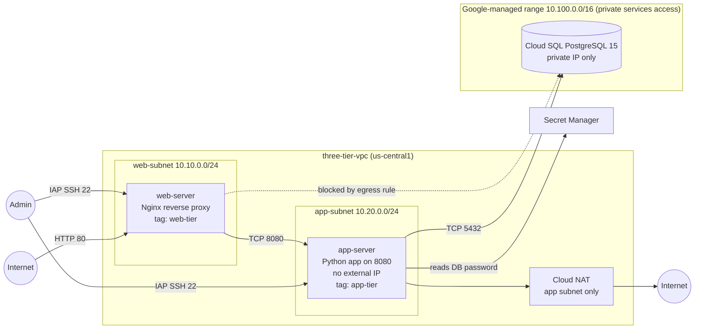
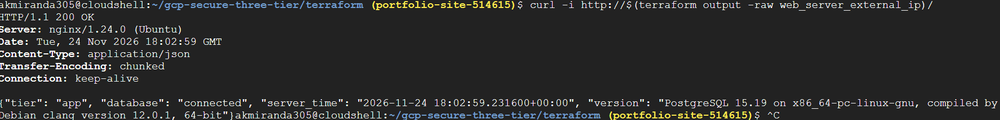
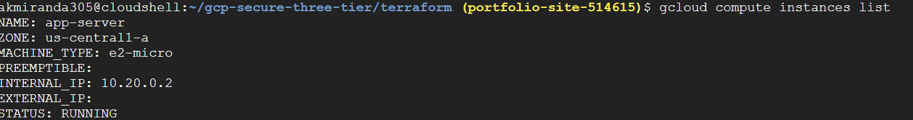
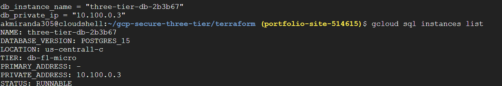
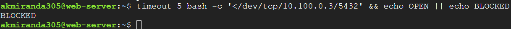
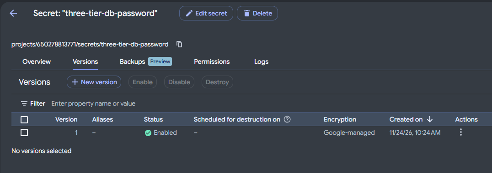
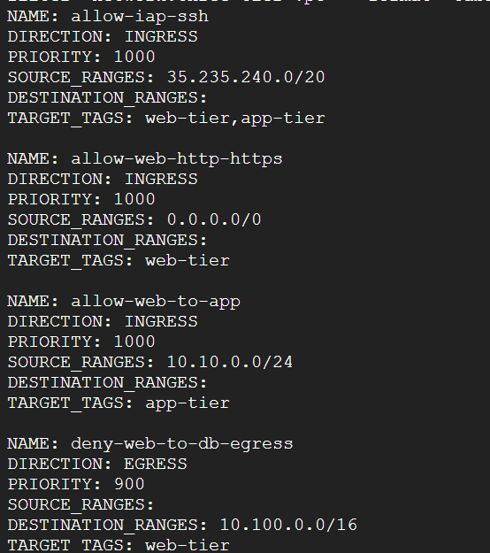

# GCP Secure Three-Tier Architecture

A segmented three-tier architecture on Google Cloud, built entirely with Terraform. A public web tier proxies to a private application tier, which reads its database password from Secret Manager and talks to a private-IP Cloud SQL (PostgreSQL) instance.

## Business Problem

A small company needs a cloud environment where the database is never reachable from the internet, each tier can talk only to the tier it depends on, and the whole environment can be rebuilt consistently from code instead of by hand-configuring consoles, which is where mistakes creep in.

## Architecture



| Tier | Resource | Network placement | Reachable from |
|------|----------|-------------------|----------------|
| Web | Compute Engine VM (Ubuntu 24.04, Nginx) | web-subnet, temporary external IP | Internet on 80/443; IAP for SSH |
| Application | Compute Engine VM (Python service) | app-subnet, no external IP | Web tier on 8080; IAP for SSH |
| Database | Cloud SQL PostgreSQL 15 | Google-managed range via private services access, no public IP | App tier only |

## Key Decisions

**1. Cloud SQL on a private IP through private services access.** Cloud SQL isn't deployed into a subnet. With a private IP it lives in a Google-managed network peered to the VPC, using a reserved range (10.100.0.0/16). My original design had a dedicated `db-subnet` and an `allow-app-to-db` ingress rule, but those don't govern traffic to a managed instance. I removed both rather than leave controls in the repo that don't control anything.

**2. Egress deny from the web tier to the database range.** VPC ingress rules protect VMs, not Cloud SQL's peered range, so network-level separation of the web tier from the database had to be enforced on the way out. The `deny-web-to-db-egress` rule (priority 900, targeting `web-tier`) blocks the web tier from the Google-managed range. The app tier is unaffected. A connection attempt from the web VM to the database on 5432 is blocked, while the app VM connects normally.

**3. Secret Manager and one service account per tier.** The database password is generated by Terraform, stored in Secret Manager, and fetched by the app VM at boot using its own service account. That account has the Secret Accessor role on this one secret and nothing else. The web tier's service account has no roles, and no VM uses the default Compute Engine account.

**4. Cloud NAT scoped to the app subnet.** The app VM has no external IP but needs outbound access for package installs. NAT is attached to `app-subnet` only, so the web tier doesn't get outbound NAT by default.

**5. IAP for administration.** SSH is allowed only from Google's IAP range (35.235.240.0/20). There is no public SSH and no bastion host to maintain.

## Verification

| Check | Result | Evidence |
|-------|--------|----------|
| Request through all three tiers | HTTP 200, JSON containing `"database": "connected"` |  |
| App tier has no public IP | `EXTERNAL_IP` empty |  |
| Cloud SQL has no public IP | No public address, private 10.100.x.x address |  |
| Web VM cannot reach the database | Connection to 5432 blocked |  |
| DB password in Secret Manager | Secret present, access limited to app service account |  |
| Final firewall rules | Four rules |  |
| Subnets | web-subnet and app-subnet |  |

## Deploy It Yourself

**Prerequisites:** a GCP project with billing enabled, Terraform 1.5 or later, the `gcloud` CLI authenticated, and a GCS bucket for Terraform state (update the bucket name in `terraform/providers.tf`).

1. Enable the APIs:
   ```
   gcloud services enable compute.googleapis.com sqladmin.googleapis.com servicenetworking.googleapis.com secretmanager.googleapis.com iam.googleapis.com cloudresourcemanager.googleapis.com
   ```
2. Clone the repo and configure variables:
   ```
   git clone https://github.com/akmiranda305-CloudEng/gcp-secure-three-tier.git
   cd gcp-secure-three-tier/terraform
   cp terraform.tfvars.example terraform.tfvars
   ```
   Edit `terraform.tfvars` and set `project_id`. This file is gitignored.
3. Deploy (Cloud SQL takes roughly 10 to 20 minutes):
   ```
   terraform init
   terraform plan
   terraform apply
   ```
4. Test the full chain:
   ```
   curl -i http://$(terraform output -raw web_server_external_ip)/
   ```
5. Tear down when finished:
   ```
   terraform destroy
   ```
   If destroy fails on the private service connection, Cloud SQL deletion is probably still finishing. Wait a few minutes and run it again.

## Repository Structure

```
gcp-secure-three-tier/
├── docs/images/                 # verification screenshots
├── terraform/
│   ├── providers.tf             # providers and GCS remote state
│   ├── variables.tf
│   ├── network.tf               # VPC and subnets
│   ├── firewall.tf              # ingress rules
│   ├── firewall_egress.tf       # web tier to database egress deny
│   ├── nat.tf                   # Cloud Router and NAT
│   ├── database.tf              # private services access and Cloud SQL
│   ├── secrets.tf               # generated password and Secret Manager
│   ├── iam.tf                   # per-tier service accounts and bindings
│   ├── app.tf                   # application tier VM
│   ├── web.tf                   # web tier VM
│   ├── outputs.tf
│   ├── scripts/                 # VM startup script templates
│   └── terraform.tfvars.example
├── .gitignore
└── README.md
```

## What I Would Do Differently in Production

- **Database resilience:** regional high availability, automated backups, point-in-time recovery, and deletion protection. All are disabled here to keep costs low and teardown simple.
- **Credentials:** use IAM database authentication or the Cloud SQL Auth Proxy instead of a password. The generated password also sits in Terraform state, so state access has to be tightly controlled.
- **Edge:** put an HTTPS load balancer with Cloud Armor in front of the web tier instead of a VM with a temporary external IP serving plain HTTP.
- **Compute:** use managed instance groups with autoscaling and health checks rather than single VMs.
- **Egress:** apply a default-deny egress policy to every tier with explicit allows, instead of blocking one destination range.
- **Observability:** VPC flow logs, alerting on firewall and NAT activity, and application monitoring.
- **Delivery:** run the Terraform through a CI/CD pipeline with plan on pull requests and a manual approval gate before apply.

## Cost Management

Billable resources (Cloud SQL, the two VMs, and Cloud NAT) were destroyed after testing. The environment is rebuilt with `terraform apply`.

## Technologies and Skills Demonstrated

Google Cloud Platform, Terraform, remote state in GCS, VPC design and segmentation, firewall ingress and egress rules, Cloud SQL private IP and private services access, Cloud NAT, Identity-Aware Proxy, Secret Manager, IAM least privilege with per-tier service accounts, Nginx reverse proxying, Linux, Git and GitHub.
